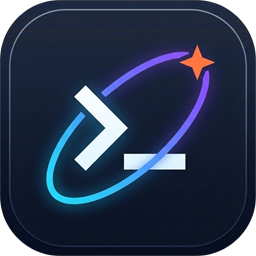

# ZeroG Code — Official Releases

<p align="center">
  
</p>

Prebuilt release packages and one-shot deployment tools for **ZeroG Code** — an unofficial Claude Code-style multi-tab AI coding workspace for VS Code / Cursor powered by **Antigravity CLI (`agy acp`)** and the integrated **Gemini Web Bridge**.

> **Unofficial** community extension, not affiliated with or endorsed by Google. "Antigravity" is used only to describe compatibility with the Antigravity CLI (`agy`).
>
> Release Repository: [https://github.com/orinplin99-maker/ZeroG-Code-release](https://github.com/orinplin99-maker/ZeroG-Code-release) · Full Deployment Guide: [**DEPLOY.md**](DEPLOY.md) · Changelog: [**CHANGELOG.md**](CHANGELOG.md)

## Latest Release (`v0.7.7`)

| Artifact | Component | Version |
|---|---|---|
| `dist/zerog-code-0.7.7.vsix` | ZeroG Code VS Code / Cursor Extension (`orinplin99-maker.zerog-code`) | `0.7.7` |
| `dist/zerog-code-chrome-extension-2.6.7.zip` | ZeroG Code — Gemini Web Bridge (Chrome MV3 Extension) | `2.6.7` |
| `web-bridge/` | Local Web Bridge daemon (`127.0.0.1:18765`), MCP server & unpacked Chrome extension | `2.6.7` |
| `skills/zerog-code-deploy/` | Automated deployment Skill + one-shot Windows PowerShell installer (`deploy.ps1`) | `0.7.7` |
| `release.json` | Release metadata and SHA-256 checksums | `0.7.7` |

## Quick Install (Windows)

### Option 1: One-Shot Full-Stack Deploy (Recommended)

Clone this repository and run from the repository root:

```powershell
# Deploy to VS Code (auto-installs agy CLI if missing, installs VSIX, starts Web Bridge, registers MCP)
powershell -ExecutionPolicy Bypass -File .\skills\zerog-code-deploy\scripts\deploy.ps1 -UsePrebuilt -InstallSkill -OpenChromeExt

# Deploy to both VS Code and Cursor:
powershell -ExecutionPolicy Bypass -File .\skills\zerog-code-deploy\scripts\deploy.ps1 -Editor code,cursor -UsePrebuilt -InstallSkill -OpenChromeExt
```

Then complete the one-time Chrome extension step:
1. Open Chrome → `chrome://extensions/` → enable **Developer mode**.
2. Click **Load unpacked** → select `%USERPROFILE%\.gemini\web-bridge\chrome-extension`.
3. Sign in at `https://gemini.google.com`.
4. In VS Code / Cursor run **`Developer: Reload Window`**, then press `Ctrl+Shift+Alt+N` (or click **ZeroG** in the status bar).

### Option 2: AI Agent Deployment

Copy `skills/zerog-code-deploy/` into `%USERPROFILE%\.gemini\config\skills\zerog-code-deploy` (or `%USERPROFILE%\.claude\skills\zerog-code-deploy`), then ask your AI agent to **"部署 ZeroG Code"**.

### Option 3: Manual Offline Install

See [**DEPLOY.md**](DEPLOY.md) for manual installation steps, verification commands, and troubleshooting.
